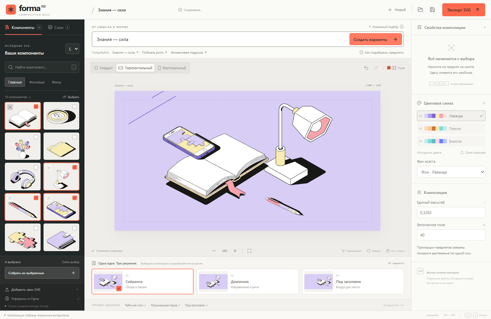

# Forma /02 — Composition Desk

Редактор композиций из исходной SVG-библиотеки для тестового задания Junior AI Developer. React, TypeScript, Vite, нативный SVG и Pointer Events. Внутри результата остаются редактируемые векторные группы.

В основе — 40 оригинальных объектов S/L, шесть векторных фонов и три предоставленные цветовые схемы. Редактор не рисует новые иллюстрации и не заменяет компоненты растром.



## Запуск

Нужен Node.js 22.12+ или Node.js 24 LTS. Для воспроизводимой установки используйте pnpm 10 и сохранённый lockfile:

```sh
pnpm install --frozen-lockfile
pnpm dev
```

Откройте адрес из терминала, обычно `http://127.0.0.1:5173/`. При наличии npm можно использовать `npm install`, затем `npm run dev`.

```sh
pnpm build             # TypeScript + production-сборка
pnpm preview           # Просмотр production-сборки
pnpm test              # 192 проверки модели, SVG, подбора и компоновки
pnpm test:e2e          # 9 браузерных сценариев, нужен Microsoft Edge
pnpm verify:sources    # Контрольные суммы 40 оригинальных предметов
pnpm format            # Форматирование кода, без изменения SVG-исходников
```

После установки приложение работает локально без аккаунта и платного API. Ввод, проекты и файлы не отправляются в Figma, LLM или другой внешний сервис. localStorage — рабочая копия, скачанный JSON — переносимый проект.

## Сценарий за минуту

1. Введите **«Знания — сила»** и нажмите **«Создать варианты»**. Можно нажать готовую подсказку под строкой.
2. Сравните три реальных SVG-предпросмотра: **«Собранно»**, **«Диагональ»**, **«Под заголовок»**. Выберите понравившийся.
3. Выберите формат, палитру и набор S/L. Формат адаптируется одним коэффициентом; варианты пересчитываются для нового формата.
4. Доведите результат: перетащите целый предмет, поверните маркером, измените порядок слоёв или состояние главного/фонового объекта.
5. Скачайте SVG и JSON. JSON можно открыть обратно, сохранив исходники, координаты, порядок, цвета и общий масштаб.

Другие запросы: **«Поймать ритм»**, **«Финансовая подушка»**, **«Яркие идеи»**, **«Всё на своих местах»**, **«Знаки внимания»**. Также работают названия предметов, их словоформы и пользовательские теги.

Это **локальный смысловой словарь и набор правил**, а не LLM. Через «Как подобраны предметы» можно увидеть тему, причину выбора, исключения и нераспознанные слова. Например, «Поймать ритм без телефона» исключает телефон; «Телефоном на фоне наушников» выбирает главный телефон и существующие фоновые наушники. Для неизвестного дракона новый объект не появляется.

## Что изменилось после MVP

- Вместо равномерной сетки — группа вокруг фокусного предмета, проверка пересечений и отдельная логика для широкого, квадратного и вертикального форматов.
- Вместо одного результата — три варианта по тому же набору исходников. Выбор фокуса в библиотеке меняет построение группы, не масштабируя предмет отдельно.
- Вместо буквального поиска — шесть объяснимых тем, устойчивые метафоры, синонимы, словоформы, простые исключения и выбор фонового состояния.
- Интерфейс занимает рабочее окно: тёмная библиотека, светлый холст, отдельная панель свойств, варианты под холстом и коралловый акцент действий.
- Добавлены масштаб просмотра, вписывание, поворот маркером, клавиатурное перемещение и быстрые действия. Параметры проекта отделены от масштаба просмотра.
- Сохранены SVG-конвейер, JSON-формат, исходная библиотека, существующие сценарии и проверки. Первая версия сохранена в истории Git (коммит `efb3e2a`); локально также есть тег `baseline-mvp-2026-11-02`.

Подробности: [дизайн и технические решения](docs/DESIGN.md), [проверки](VALIDATION.md), [план видео на 60–90 секунд](docs/DEMO.md).

## Редактор

### Компоненты и слои

Нажатие на предмет добавляет целый SVG на холст. Галочки формируют набор для автоматической сборки; маленькая мишень задаёт фокус. Роли «Главные», «Фоновые» и «Фоны» относятся к существующим исходникам.

Переключение главного/фонового состояния выбирает соответствующий файл того же семейства. S/L выбирает настоящие разные исходники. Если соответствующего варианта нет, редактор сообщает об этом, не подставляя похожую картинку. При импорте собственных пар используйте одинаковое базовое имя файла и задайте роль/набор в раскрываемом блоке «Добавить свои SVG».

Во вкладке «Слои» верхний элемент ближе к зрителю. Порядок также меняется в свойствах выбранного объекта.

### Управление

| Действие                | Управление                                                  |
| ----------------------- | ----------------------------------------------------------- |
| Перемещение             | Pointer drag целого объекта                                 |
| Поворот                 | Круглый маркер над выделением или числовое поле             |
| Поворот с шагом 15°     | Shift при перетаскивании маркера                            |
| Точное перемещение      | Стрелки: 1 px; Shift + стрелки: 10 px                       |
| Дублирование            | Ctrl/Cmd + D или кнопка в свойствах                         |
| Удаление                | Delete / Backspace или кнопка                               |
| Отмена / повтор         | Ctrl/Cmd + Z / Ctrl/Cmd + Shift + Z; последние 30 изменений |
| Снять выделение         | Escape или пустое место холста                              |
| Поиск компонентов       | `/`, когда фокус вне текстового поля                        |
| Масштаб просмотра       | `+` / `−`, Ctrl/Cmd + колесо над холстом                    |
| Реальные 100% / вписать | Нажатие на процент / кнопка вписывания                      |

Масштаб просмотра не меняет координаты, относительные размеры или экспорт. Размер предметов изменяется только общим коэффициентом композиции. Растяжения по одной оси и редактирования частей объекта нет.

Изменение варианта заменяет компоновку выбранного набора; отмена возвращает предыдущую ручную доводку. Демонстрационный сценарий открывает подготовленный проект; предыдущий проект также остаётся в истории отмены. Для переносимой копии используйте JSON.

### Палитры

Встроены «Лаванда», «Персик», «Бирюза». Палитра применяется ко всей композиции. Главные предметы используют объектные, фоновые и нейтральные цвета. Фоновые предметы и фон холста — фоновые и нейтральные.

Пример загружаемого JSON (`assets/palettes/lavender.json`):

```json
{
  "name": "Лаванда",
  "background": ["#D7CDF5", "#AA9BF0", "#7864D7"],
  "objects": ["#F9ECB0", "#F9A3AA", "#FFE3E1"],
  "neutral": ["#181817", "#FFFFFF"]
}
```

Порядок задаёт три оттенка фона, три акцента и тёмный/светлый нейтральный цвет. Геометрия, `none`, ссылки на градиенты и отдельные атрибуты прозрачности сохраняются. Для известных исходников используются цветовые роли; неизвестные цвета пользовательского SVG распределяются детерминированно по допустимым цветам схемы. «Исходные цвета» возвращает исходник, а не результат обратной перекраски.

## Как собирается композиция

1. Подбор возвращает только существующие `assetId` подходящей детализации. В базовом режиме это словарь, не вызов LLM.
2. Фокус задаётся явно либо выбирается из главных предметов по их исходным размерам. Фокус влияет на расположение и порядок слоёв.
3. Опорные позиции определяются семействами предметов и вариантом. Например, телефон может опираться на книгу, а лампа занимать боковую часть группы.
4. Детерминированный поиск проверяет пересечения повёрнутых bounding box. Сильное наложение разрешено для осмысленных пар вроде книги и телефона; прочие главные предметы разделяются.
5. Вся группа вписывается **одним** коэффициентом. Главные предметы остаются внутри безопасной зоны. У фоновых проверяется видимость не менее 65% каждой bounding-размерности, остальное может обрезаться границей холста.
6. В варианте под заголовок свободна левая часть широкого холста или верхняя часть квадратного/вертикального. Заголовок в экспорт не добавляется.

Для трёх вариантов используются одни исходники; различаются композиция, пространственный ритм, повороты и свободная зона. Случайных чисел нет. При обычном переключении формата существующая ручная композиция адаптируется общим коэффициентом; чтобы получить новую раскладку, выберите пересчитанный вариант.

## Архитектура

| Модуль                       | Ответственность                                                     |
| ---------------------------- | ------------------------------------------------------------------- |
| `src/model.ts`               | Типы, форматы, общий масштаб, обратимая адаптация и границы         |
| `src/svg.ts`                 | Проверка SVG, копия для рендера, изоляция ID/CSS, векторный экспорт |
| `src/library.ts`             | Оригинальные объекты, семейства, роли, S/L                          |
| `src/palettes.ts`            | Проверка схемы и цветовые роли                                      |
| `src/semantics.ts`           | Словарь тем/метафор, словоформы, исключения, объяснение             |
| `src/composition.ts`         | Фокус, пространственная группа, пересечения, общий fit, обрезка     |
| `src/planner.ts`             | Контракт планировщика, проверка плана, применение                   |
| `src/project.ts`             | Проверка JSON и повторное извлечение метаданных из исходников       |
| `src/App.tsx`                | Состояние, история, файлы и координация действий                    |
| `src/ui/`                    | Библиотека, холст, свойства, SVG-предпросмотры, варианты            |
| `src/core.test.ts`           | Сохранённые проверки SVG и основного контракта                      |
| `src/design.test.ts`, `e2e/` | Подбор, качество размещения и браузерные сценарии                   |

`Asset.source` хранится без переписывания. Рендер и экспорт работают с DOM-копией: изолируют ID и локальные ссылки, меняют допустимые цвета, добавляют внешние преобразования. Внутренние пути предметов не разбиваются на редактируемые части и не заменяются.

Экспорт содержит отдельную `<g data-source-id="…">` для каждого экземпляра, исходный вложенный SVG с viewBox и группами. UI-рамки, hit-area, иконки, маркеры и безопасные поля не экспортируются. Обрезка холста реализована вложенным SVG-viewport, без растрирования и новых графических примитивов.

Координаты указателя переводятся через обратную `getScreenCTM()`. Это сохраняет корректность drag/rotate при масштабе просмотра. Запись проекта включает источники, позиции, повороты, порядок, общий масштаб, палитру, фон и детализацию. При открытии JSON метаданные заново вычисляются из проверенного SVG.

### Будущий AI-планировщик

`CompositionPlanner.plan(PlanRequest)` возвращает только `assetId`, позиции, повороты, один общий масштаб, фокус и объяснение. Контракт не содержит новой SVG-разметки, изображений, path или произвольных цветов. Перед применением нужен разбор ответа по схеме и `validatePlan`: неизвестные ID, некорректные числа и выход главных объектов за поле отклоняются.

Удалённый адаптер можно добавить на сервере; ключи не должны попадать в Vite-клиент. Текущая версия не обращается к LLM и не требует ключа.

## Три демонстрации

SVG и переносимые JSON находятся в `examples/`. Их можно открыть кнопками внизу рабочей области или через «Открыть JSON».

| Пример                              | Формат / палитра    | Смысл и предметы                                                              |
| ----------------------------------- | ------------------- | ----------------------------------------------------------------------------- |
| `composition-1` — Рабочий стол      | 1200×630 / Персик   | Книга как опора; телефон, лампа, ручка, пазлы поддерживают тему работы/учёбы  |
| `composition-2` — Музыкальная пауза | 1000×1000 / Лаванда | Фокус на наушниках; телефон и фоновые цветы, диагональный ритм                |
| `composition-3` — Под заголовок     | 630×1200 / Бирюза   | Финансовый сценарий: кошелёк, монета, фоновый телефон; свободная верхняя зона |

Все примеры собраны из L-источников. Переключение на S выбирает предоставленные S-файлы. В тестах проверены открытие JSON, повторный экспорт, отдельные векторные группы и неизменность геометрии. Ручной обратный импорт в Figma в этой сессии не проверялся; полная совместимость каждого SVG-редактора не заявляется.

## Материалы и инструменты

Подробный [инвентарь материалов](assets/figma/INVENTORY.md) описывает 73 PNG из исходных архивов, отдельные SVG и обзорные листы. PNG во вкладке «Референсы» служат для визуального сравнения. Авторство готовых `SVG-drop…`-примеров не установлено; они не используются как исходные компоненты или собственный результат.

`assets/figma/svg/manifest.json` фиксирует SHA-256 40 предметов и три точных повтора отправок. Оригинальные архивы остались без изменений. Пароли и данные аккаунта в проект не записывались.

Реально использованные AI-инструменты: **OpenAI Codex** — помощь в архитектуре, реализации, тестах и итерациях интерфейса. В самом приложении используется локальный словарь/правила. Новые AI-иллюстрации не создавались. Иконки интерфейса — [Lucide React](https://lucide.dev/guide/react/); они не попадают в композицию.

## Ограничения

- Смысловой подбор ограничен шестью темами, словарём выражений и простыми правилами. Произвольная новая метафора может не распознаться; неизвестные слова показываются пользователю. Для прямых названий выбираются названные предметы, без произвольного расширения набора.
- Компоновщик — экспертные правила и геометрический поиск, не художественная модель. Лучше всего читаются группы из 2–5 предметов. Технически разрешено до 24 выбранных компонентов; большие наборы могут стать визуально плотными или мелкими.
- Пересечения, поля и обрезка считаются по повёрнутому viewBox, не по реальному силуэту. Фильтры, маркеры и выступающий stroke могут потребовать более свободного поля в исходнике. Ручное редактирование может вывести объект за поля; интерфейс предупреждает, SVG обрезается по холсту.
- Фон холста заполняет формат равномерным `slice`; общий масштаб **предметов** к нему не применяется. Фоновые предметы используют тот же коэффициент, что главные. S/L сохраняет собственные размеры каждого набора, не исправляя индивидуально различия исходных вариантов.
- Поддерживается статический SVG с геометрией, группами, defs, локальными ссылками, градиентами, clipPath и ограниченным CSS. Скрипты, растр, foreignObject, анимация, внешние ресурсы, @-правила, псевдо-/атрибутные селекторы и динамический CSS отклоняются. Сложные маски, фильтры и внешние шрифты требуют отдельной визуальной проверки.
- SVG: до 2 МБ; JSON: до 25 МБ; библиотека: до 100 компонентов; холст: до 300 экземпляров. Палитра имеет структуру 3+3+2. При нехватке localStorage скачайте JSON.
- Исходная библиотека включена в клиентский JS (~2 МБ до gzip). Следующий шаг для большого каталога — ленивое чтение SVG и IndexedDB. Проверки выполнены в Microsoft Edge; Firefox и Safari отдельно не проверялись.

Исходный код опубликован в этом репозитории. Приложение запускается локально по инструкции выше; размещённой веб-версии нет.

Для проверки результата: [отчёт проверок](VALIDATION.md), [сценарий демонстрации](docs/DEMO.md), [рабочий стол — SVG](examples/composition-1.svg), [музыкальная пауза — SVG](examples/composition-2.svg), [финансовая композиция — SVG](examples/composition-3.svg). Рядом с каждым SVG сохранён JSON для повторного открытия в редакторе.
